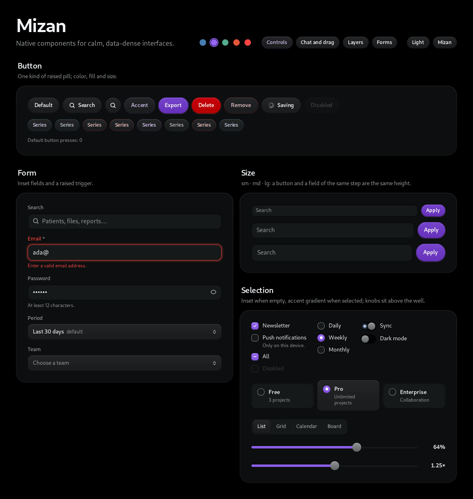
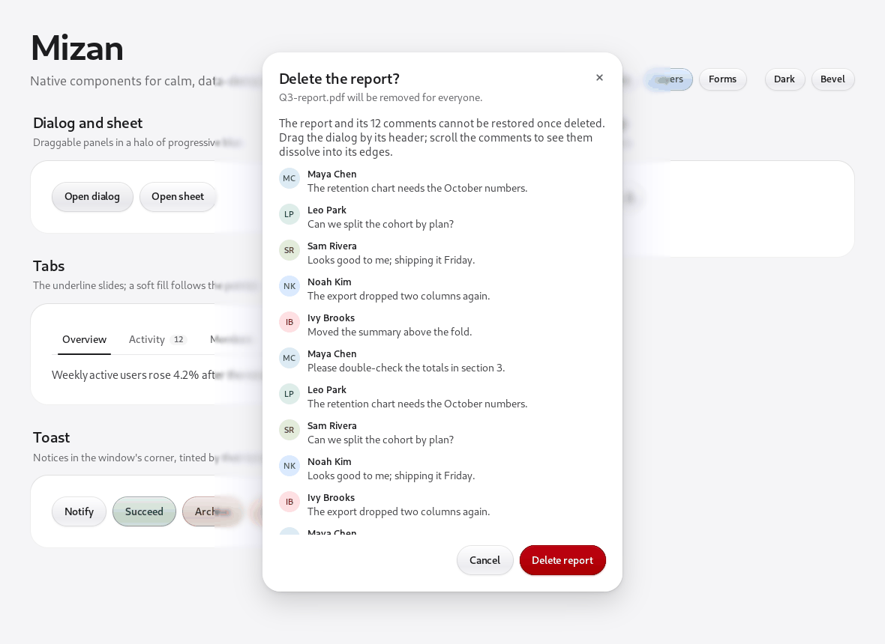

# Mizan for MyGo

Mizan is a design system for calm, data-dense interfaces. This is its
native edition: components for [MyGo](https://github.com/egoist/mygo)'s
native UI (package `ui`), drawn by MyGo itself on macOS, Linux, Windows and
in the browser, in pure Go without cgo.

It ports Mizan's visual language, not its web code: the same OKLCH tokens,
the same two surfaces (a raised control that takes the light from above, an
inset well you type into), the same size steps and type scale. Behavior
(focus, keyboard, accessibility) comes from MyGo's unstyled `…Base` widgets;
Mizan gives them the look.


## Install

```sh
go get github.com/imhalid/mizan-go
```

```go
import (
	"github.com/egoist/mygo/ui"
	mizan "github.com/imhalid/mizan-go"
)

func (a *app) view(c *ui.Context) {
	t := mizan.Root(c, mizan.Options{})
	mizan.Card(c, mizan.CardOptions{Title: "Report", Pad: true}, func() {
		mizan.Field(c, mizan.FieldOptions{Label: "Search"}, func() {
			mizan.Input(c.Key("q"), &a.query, mizan.InputOptions{Label: "Search", Clearable: true})
		})
		if mizan.Button(c.Key("go"), "Apply", mizan.ButtonOptions{Color: t.Colors.Accent, Variant: mizan.Solid}).Clicked() {
			a.apply()
		}
	})
	mizan.Toaster(c)
}
```

Run the gallery, a tour of every component:

```sh
go run github.com/imhalid/mizan-go/cmd/gallery@latest
```

## Theming

`Root` themes the window and `Scope` a region; fields left unset are
inherited, and the nearest scope wins.

- **Mode:** `Light`, `Dark`, or the system's appearance.
- **Skin:** `SkinMizan`, or `SkinBevel` (raised edges, metal knobs, an LED switch).
- **Size:** `Sm`, `Md`, `Lg`. A button and a field of the same step are the same height.
- **Accent:** a brand color. The accent ramp, selection fills and rings take its hue and chroma at Mizan's lightness steps, so contrast holds in both themes.

```go
mizan.Root(c, mizan.Options{Skin: mizan.SkinBevel, Accent: ui.Oklch(0.56, 0.2, 295)})
mizan.Scope(c, mizan.Options{Size: mizan.Sm}).Children(func() { ... })
```

The tokens are Go values in [tokens.go](tokens.go), written in OKLCH.



## Components

| Group | Components |
| --- | --- |
| Controls | `Button`, `Input`, `Select`, `Field`, `Card` |
| Selection | `Checkbox`, `Radio`, `Choice`, `Switch`, `Segmented`, `Slider` |
| Forms | `Textarea`, `NumberInput`, `Combobox`, `DatePicker`, `TagInput` |
| Navigation | `Tabs`, `TabPanel` |
| Layers | `Dialog`, `Sheet`, `Popover`, `Menu`, `MenuButton`, `Tooltip`, `Toaster` |
| Chat | `Message`, `Typing`, `DaySeparator`, `Composer` |
| Drag and drop | `Sortable`, `DragCard`, `DropArea`, `DropZone`, `FileItem` |
| Indicators | `Badge`, `Tag`, `StatusDot`, `Kbd`, `Avatar`, `EmptyState` |


## Layers

Layers move on quick springs.

- **Dialogs** drag by their header: they lean into the motion, glide on when thrown and spring back inside the window.
- **Halo instead of a scrim:** dialogs and sheets don't dim the window. A halo of progressive blur surrounds them, strongest along their edge.
- **Scroll edges:** content scrolling inside a dialog or sheet dissolves into its header and footer under a progressive blur.
- **Glass:** popovers, menus, tooltips and toasts are frosted glass, from MyGo's `plugins/glass`.
- **Toasts:** they come from MyGo's `Context.AddToast`. Older ones tuck behind the newest and spread out under the pointer.




## Development

```sh
go vet ./...
go test ./...         # interaction tests through ui.Tester
go test -short ./...  # skips the tests that draw blur on the CPU
MIZAN_SNAPSHOTS=/tmp/mizan go test -run 'Snapshot|SelectOpen' ./gallery/   # PNGs of every page
```

Everything builds with `CGO_ENABLED=0` for Linux, macOS, Windows and
`js/wasm`. CI runs all of it and keeps the snapshots as an artifact.

## License

[MIT](LICENSE)
