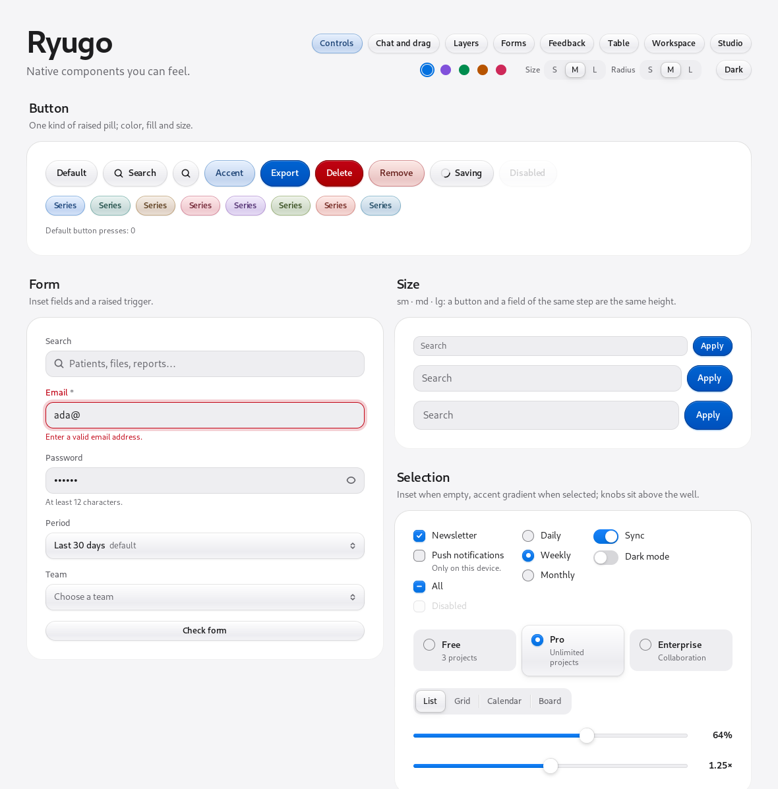
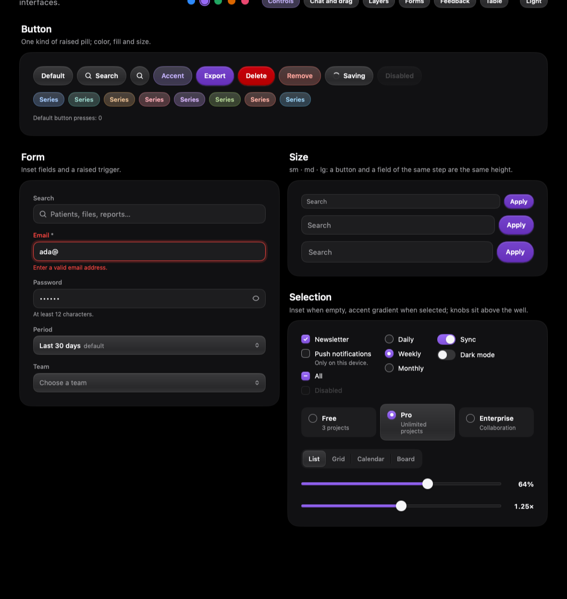
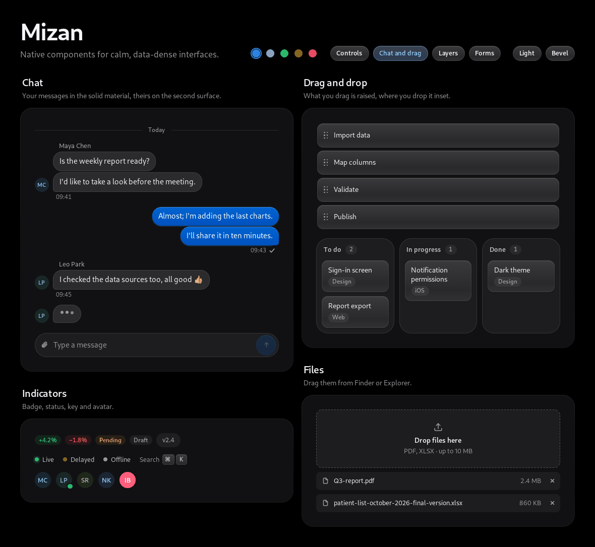
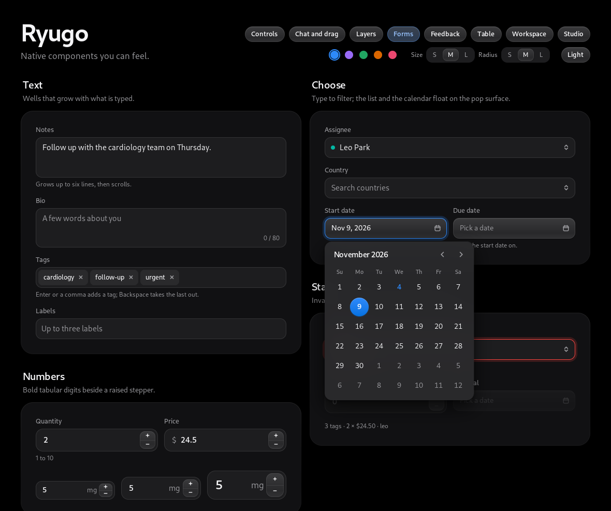
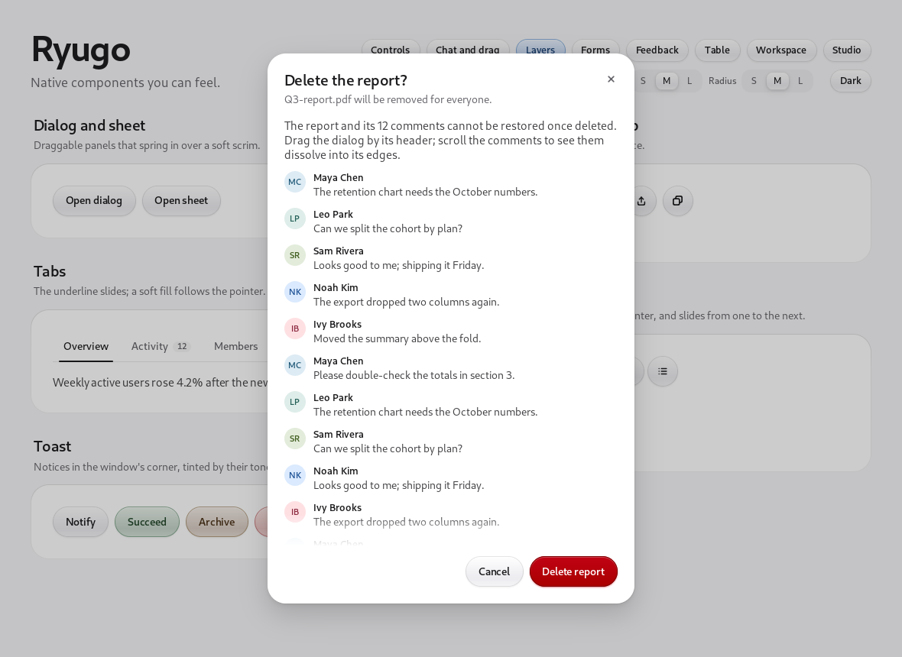
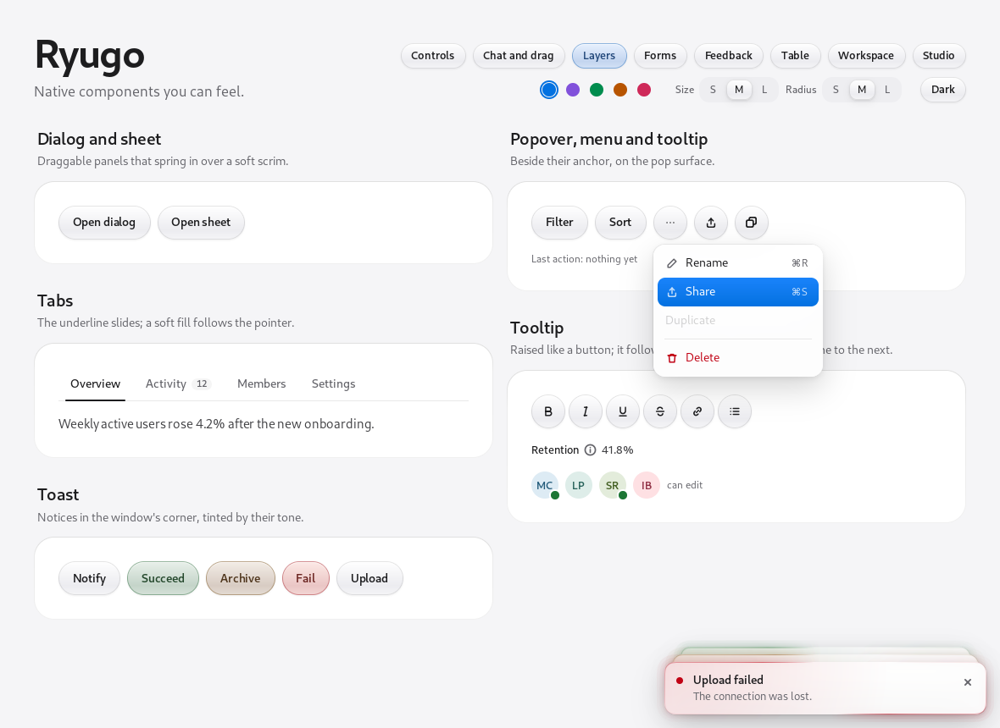

# Mizan for MyGo

Mizan is a design system for calm, data-dense interfaces. This is its
native edition: components for [MyGo](https://github.com/egoist/mygo)'s
native UI (package `ui`), drawn by MyGo itself on macOS, Linux, Windows and
in the browser, in pure Go without cgo.

It ports Mizan's visual language, not its web code: the same OKLCH tokens,
the same two surfaces (a raised control that takes the light from above, an
inset well you type into), the same size steps and type scale. Behavior
(focus, keyboard, accessibility) comes from MyGo's unstyled `…Base` widgets;
Mizan gives them the look.



## Install

```sh
go get github.com/imhalid/mizan-go
```

```go
import (
	"github.com/egoist/mygo/ui"
	mizan "github.com/imhalid/mizan-go"
)

func (a *app) view(c *ui.Context) {
	t := mizan.Root(c, mizan.Options{})
	mizan.Card(c, mizan.CardOptions{Title: "Report", Pad: true}, func() {
		mizan.Field(c, mizan.FieldOptions{Label: "Search"}, func() {
			mizan.Input(c.Key("q"), &a.query, mizan.InputOptions{Label: "Search", Clearable: true})
		})
		if mizan.Button(c.Key("go"), "Apply", mizan.ButtonOptions{Color: t.Colors.Accent, Variant: mizan.Solid}).Clicked() {
			a.apply()
		}
	})
	mizan.Toaster(c)
}
```

Run the gallery, a tour of every component:

```sh
go run github.com/imhalid/mizan-go/cmd/gallery@latest
```

## Theming

`Root` themes the window and `Scope` a region; fields left unset are
inherited, and the nearest scope wins.

- **Mode:** `Light`, `Dark`, or the system's appearance.
- **Size:** `Sm`, `Md`, `Lg`. A button and a field of the same step are the same height.
- **Corners:** `CornersSm`, `CornersMd`, `CornersLg`: the radii of cards, fields, menus and tables at half, at, or one and a half times Mizan's. Pills and circles keep their shape, and a surface nested inside another keeps its corners concentric with it (`Concentric`: the outer radius less the padding).
- **Accent:** a brand color. The accent ramp, selection fills and rings take its hue and chroma at Mizan's lightness steps, so contrast holds in both themes.

```go
mizan.Root(c, mizan.Options{Accent: ui.Oklch(0.56, 0.2, 295), Corners: mizan.CornersLg})
mizan.Scope(c, mizan.Options{Size: mizan.Sm}).Children(func() { ... })
```

The tokens are Go values in [tokens.go](tokens.go), written in OKLCH.



## Components

| Group | Components |
| --- | --- |
| Controls | `Button`, `Input`, `Select`, `Field`, `Card` |
| Selection | `Checkbox`, `Radio`, `Choice`, `Switch`, `Segmented`, `Slider` |
| Forms | `Textarea`, `NumberInput`, `Combobox`, `DatePicker`, `TagInput` |
| Navigation | `Tabs`, `TabPanel`, `Link` |
| Disclosure | `Collapsible`, `Accordion` |
| Toolbars | `Toggle`, `ToggleGroup`, `Separator` |
| Layers | `Dialog`, `Sheet`, `Popover`, `Menu`, `MenuButton`, `Tooltip`, `Toaster` |
| Chat | `Message`, `Typing`, `DaySeparator`, `Composer` |
| Drag and drop | `Sortable`, `DragCard`, `DropArea`, `DropZone`, `FileItem` |
| Indicators | `Badge`, `Tag`, `StatusDot`, `Kbd`, `Avatar`, `EmptyState` |
| Feedback | `Progress`, `Meter`, `Spinner`, `Skeleton`, `SkeletonText` |
| Data | `Table`, `Pagination` |





## Layers

Layers move on quick springs: they spring in, and leave faster than they came.

- **Dialogs** drag by their header: they lean into the motion, glide on when thrown and spring back inside the window.
- **Dialogs and sheets** come in over a soft scrim that fades in with them: a dialog rises from 94%, a sheet slides in from the edge, tilted a little. Closing, they fade or slide out, and let the pointer through to the page at once.
- **Scroll edges:** content scrolling inside a dialog or sheet fades into its header and footer.
- **Drag and drop:** a card picked up lifts and follows the pointer, leaning into the motion; the cards where it would go slide apart, and it flies into its place when let go. A column taking it glows, a cloud's shadow of the accent drifting across it, and a light runs up both its sides as it lands. Sortable rows also move with Alt+Up and Alt+Down.
- **Table:** rows built only as far as they show, sorted by a click on a header (Shift-click adds a key), chosen with checkboxes (Shift-click for a range) under a selection bar that springs in over the toolbar. A column picked up by its header lifts and the others slide aside for it; its end edge resizes it. Rows slide to their new places as the sort changes, new ones fade in, removed ones fade where they were, and a page turns sideways. Search, a view menu for columns and density, opening rows for details, a pinned first column, pages, and loading, empty and error states come with it.
- **Glass:** popovers, menus, tooltips and toasts are frosted glass, from MyGo's `plugins/glass`.
- **Toasts:** they come from MyGo's `Context.AddToast`. A new one rises from below, growing to its size, as two lights of Mizan's border beam run round it from opposite sides; older ones tuck behind it and spread out under the pointer. A swipe to the side sends one away, and a `ToastLoading` toast turns into its result in place.





## Development

```sh
go vet ./...
go test ./...         # interaction tests through ui.Tester
go test -short ./...  # skips the tests that draw glass on the CPU
MIZAN_SNAPSHOTS=/tmp/mizan go test -run 'Snapshot|SelectOpen' ./gallery/   # PNGs of every page
```

Everything builds with `CGO_ENABLED=0` for Linux, macOS, Windows and
`js/wasm`. CI runs all of it and keeps the snapshots as an artifact.

## License

[MIT](LICENSE)
